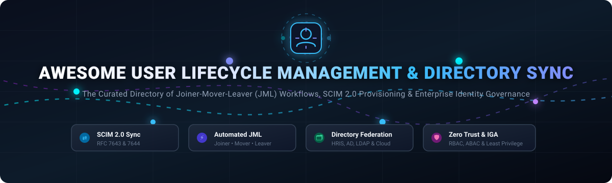

  

# 🔄 Awesome User Lifecycle Management & Directory Sync 👥✨

  
  
  
  
  

> 🌐 **A comprehensive, curated catalog of top User Lifecycle Management (ULM) and Directory Synchronization platforms.**  
> Explore premier enterprise SaaS solutions and battle-tested open-source software for automating Joiner-Mover-Leaver (JML) workflows, SCIM 2.0 provisioning, real-time identity synchronization, and automated access governance across modern identity providers, HRIS systems, and directory architectures.  
> 🌟 **Star this repository if you find it helpful!** 🌟

---

## 📋 Table of Contents

- [🌐 Sector Overview & Market Dynamics](#-sector-overview--market-dynamics)
- [🏢 SaaS & Hosted Commercial Platforms](#-saas--hosted-commercial-platforms)
- [🔓 Open-Source Software & Toolkits](#-open-source-software--toolkits)
- [📊 Feature Comparison Matrix](#-feature-comparison-matrix)
- [🤝 Contributing Guidelines](#-contributing-guidelines)
- [💖 Support & Sponsorship](#-support--sponsorship)
- [📈 Star History](#-star-history)
- [📜 License](#-license)

---

## 🌐 Sector Overview & Market Dynamics

The global Identity and Access Management (IAM) and Identity Governance and Administration (IGA) market is valued at approximately **$18 billion to $22 billion in 2024 and is projected to surpass $45 billion by 2032**, expanding at a robust compound annual growth rate (CAGR) of 13% to 15%. 

The user lifecycle management and directory sync sector exhibits **moderate fragmentation with high concentration among mega-cap enterprise cloud ecosystems** (such as Microsoft Entra, Okta, Google Cloud, and AWS), where platform gravity captures default enterprise identity estates. However, rapid multi-SaaS expansion and hybrid infrastructure have simultaneously fostered specialized high-growth segments in automated SCIM orchestration, HRIS-driven joiner-mover-leaver (JML) pipelines, and self-hosted open-source zero-trust IAM frameworks.

---

## 🏢 SaaS & Hosted Commercial Platforms

Below is a detailed benchmark of leading commercial, cloud-hosted User Lifecycle Management and Directory Sync platforms, sorted in descending order by parent company scale (valuation or enterprise revenue).

| Platform / Provider | Focus / Workflow Type | Scale / Valuation / Revenue | Starting Tier Pricing | Free Tier / Trial Limits | Key Capabilities |
|:--------------------|:----------------------|:----------------------------|:----------------------|:-------------------------|:-----------------|
| **[Microsoft Entra Lifecycle Workflows](https://www.microsoft.com/en-us/security/business/identity-access/microsoft-entra-id-governance)** | Identity governance & JML workflows within Entra ID | **~$3.1 Trillion Market Cap** *(Microsoft; Security revenue >$20B/yr)* | **$7/user/month** *(Entra ID Governance add-on; or $12/user/mo Entra Suite)* | **30-day free trial:** Up to 100 user licenses with full workflow automation features included. | Predefined onboarding/offboarding templates, task scheduling, execution conditions, and Azure Logic Apps integration. |
| **[Google Workspace Directory](https://workspace.google.com)** | Directory user lifecycle via Admin SDK Directory API | **~$2.1 Trillion Market Cap** *(Alphabet/Google; Cloud revenue >$35B/yr)* | **$6/user/month** *(Business Starter tier, 1-year commitment)* | **14-day free trial:** Up to 10 users with full admin console and Directory API provisioning access. | Programmatic user lifecycle management, organizational unit (OU) hierarchy, automated group memberships, and email aliases. |
| **[AWS IAM Identity Center](https://aws.amazon.com/iam/identity-center/)** | AWS multi-account workforce access & external directory sync | **~$2.0 Trillion Market Cap** *(Amazon; AWS revenue >$105B/yr)* | **Free of additional charge** *(Included with AWS account; $0 core service fee)* | **Free forever:** Connect external IdPs (SAML 2.0 / SCIM) and assign multi-account permission sets at no added cost. | Centralized workforce access to AWS accounts and SAML business applications; automated SCIM 2.0 provisioning. |
| **[CyberArk Identity](https://www.cyberark.com/products/identity-management/)** | Workforce identity admin with privileged controls | **~$12.5 Billion Market Cap** *(NASDAQ: CYBR)* | **$2/user/month** *(Single Sign-On starting tier; $4/user/mo with Adaptive MFA)* | **30-day free trial:** Full access to interactive admin portal, cloud directory sync, and adaptive SSO/MFA policies. | Automated user import from Active Directory/LDAP/Entra ID, role-based application provisioning, and service user controls. |
| **[Okta Lifecycle Management](https://www.okta.com/products/lifecycle-management/)** | Enterprise identity lifecycle & multi-source automation | **~$11.8 Billion Market Cap** *(NASDAQ: OKTA)* | **$4/user/month** *(Lifecycle Management tier; Universal Directory is $2/user/mo)* | **30-day free trial:** Dedicated sandbox tenant with full SCIM connector catalog and workflow engine access. | Automated JML workflows across HR systems, dynamic RBAC/ABAC provisioning, and Okta Identity Governance integration. |
| **[Auth0](https://auth0.com)** | Developer-focused user management & B2B directory federation | **$6.5 Billion Acquisition** *(Acquired by Okta)* | **$25/month** *(B2C Essentials; B2B Enterprise starting tier from $130/month)* | **Free forever plan:** Up to 7,500 active users, unlimited logins, social connections, and custom domains. | Universal directory profile store, Management API automation, B2B multi-tenant organization provisioning, and RBAC. |
| **[SailPoint Identity Security Cloud](https://www.sailpoint.com)** | Enterprise identity security, machine accounts & IGA | **$6.9 Billion Valuation** *(Thoma Bravo acquisition)* | **~$4/user/month** *(Estimated starting entry tier; annual enterprise licensing)* | **30-day guided POC trial:** Hands-on sandbox with automated application connectors and access certification demo. | AI-driven application onboarding, non-employee/machine identity governance, automated data ownership, and SAP IAG sync. |
| **[Druva inSync User Management](https://www.druva.com)** | Enterprise cloud backup identity & directory synchronization | **~$2 Billion Valuation** *(Private equity backed; Neuberger Berman / CDPQ)* | **$8/user/month** *(inSync Enterprise tier, annual commitment)* | **30-day free trial:** Up to 50 users and 1TB backup storage with automated directory sync enabled. | Automated AD/LDAP, Entra ID, and SCIM 2.0 user provisioning, deprovisioning synchronization, and department mappings. |
| **[Ping Identity (PingIDM)](https://www.pingidentity.com)** | Complex identity lifecycle with BPMN 2.0 workflow engine | **$2.8 Billion Valuation** *(Acquired by Thoma Bravo)* | **$3/user/month** *(PingOne workforce starting tier, billed annually)* | **30-day free trial:** Full PingOne Cloud platform sandbox with SCIM provisioning and OpenICF connectors. | BPMN 2.0 visual provisioning engine, sunrise/sunset scheduling, OpenICF connector ecosystem, and policy auditing. |
| **[JumpCloud](https://jumpcloud.com)** | Cloud-native directory platform with device & JML management | **~$2.6 Billion Valuation** *(Series F valuation)* | **$9/user/month** *(Core Directory tier, billed annually)* | **Free forever plan:** Up to 10 users and 10 managed devices with full directory, SSO, and RADIUS features included. | Cross-OS device management, cloud LDAP, SCIM provisioning, multi-tenant enterprise portal, and automated user import. |
| **[OneLogin](https://www.onelogin.com)** | Cloud IAM with flexible directory federation & provisioning | **~$500 Million Acquisition** *(Acquired by One Identity)* | **$2/user/month** *(OneLogin Enterprise Starter; $4/user/mo for Advanced)* | **30-day free trial:** Unlimited test users with directory sync connectors (Active Directory, LDAP, Google, Workday). | Real-time directory sync, Universal Directory identity mapping, automated CSV bulk provisioning, and role assignment. |

---

## 🔓 Open-Source Software & Toolkits

Self-hosted, community-driven User Lifecycle Management, Directory Sync, and IAM platforms. Ranked in descending order of GitHub community stars.

### 1. [Keycloak](https://github.com/keycloak/keycloak) 
* **Stack:** Java | **License:** Apache-2.0
* **Repository:** `keycloak/keycloak`
* **Overview:** The industry-standard open-source identity and access management system. Provides robust user federation across LDAP, Active Directory, and Kerberos, integrated SCIM 2.0 provisioning capabilities, identity brokering, dynamic role mapping, and event-driven lifecycle actions.

### 2. [Authelia](https://github.com/authelia/authelia) 
* **Stack:** Go / TypeScript | **License:** Apache-2.0
* **Repository:** `authelia/authelia`
* **Overview:** Lightweight identity and access management portal with deep directory integration. Connects directly to existing LDAP/Active Directory servers for live user synchronization, multi-factor authentication (FIDO2 WebAuthn, TOTP), and forward-auth proxy access control.

### 3. [Authentik](https://github.com/goauthentik/authentik) 
* **Stack:** Python / Go / Vue | **License:** GPL-3.0
* **Repository:** `goauthentik/authentik`
* **Overview:** An open-source, versatile Identity Provider emphasizing automated lifecycle pipelines and directory sync. Features native SCIM 2.0 outbound and inbound synchronization, LDAP Outpost server capabilities, enrollment workflows, and custom Python execution stages for joiner-mover-leaver lifecycle rules.

### 4. [Zitadel](https://github.com/zitadel/zitadel) 
* **Stack:** Go / Next.js | **License:** Apache-2.0
* **Repository:** `zitadel/zitadel`
* **Overview:** Cloud-native, event-sourced IAM built for multi-tenant organizations. Features granular B2B organizational hierarchies, machine identity lifecycle management, automated user provisioning via robust APIs, and audit trails for all lifecycle operations.

### 5. [Casdoor](https://github.com/casdoor/casdoor) 
* **Stack:** Go / React | **License:** Apache-2.0
* **Repository:** `casdoor/casdoor`
* **Overview:** UI-first, developer-friendly Identity and Access Management platform supporting OAuth 2.0, OIDC, SAML, and CAS. Features built-in bidirectional LDAP/Active Directory synchronization, automated SCIM provisioning, batch user imports/exports, and granular role assignments.

### 6. [Dex IDP](https://github.com/dexidp/dex) 
* **Stack:** Go | **License:** Apache-2.0
* **Repository:** `dexidp/dex`
* **Overview:** OpenID Connect identity broker that syncs and federates credentials from multiple backing directories (LDAP, SAML, GitHub, Google, Keystone). Acts as a single source of directory authentication for Kubernetes clusters and distributed microservices.

### 7. [Kanidm](https://github.com/kanidm/kanidm) 
* **Stack:** Rust / WebAssembly | **License:** MPL-2.0
* **Repository:** `kanidm/kanidm`
* **Overview:** Modern, fast, and secure identity management service built with memory-safe Rust. Functions as an enterprise directory server with automated credential lifecycle policies, Unix PAM/NSS integration, RADIUS/OIDC support, and fine-grained access delegation.

### 8. [BoxyHQ Jackson](https://github.com/boxyhq/jackson) 
* **Stack:** Node.js / TypeScript | **License:** Apache-2.0
* **Repository:** `boxyhq/jackson`
* **Overview:** Purpose-built enterprise directory sync and SAML SSO gateway. Implements standard SCIM 2.0 endpoints for real-time employee provisioning and deprovisioning directly from enterprise IdPs (Okta, Azure AD/Entra, OneLogin, JumpCloud) into modern SaaS databases via webhooks.

### 9. [WSO2 Identity Server](https://github.com/wso2/product-is) 
* **Stack:** Java | **License:** Apache-2.0
* **Repository:** `wso2/product-is`
* **Overview:** Digital Public Good-recognized enterprise IAM suite supporting full identity lifecycle operations. Supports inbound/outbound SCIM 2.0 provisioning, workflow approvals for onboarding, identity federation, adaptive MFA, and directory aggregation across enterprise databases.

### 10. [Janssen Project (Jans)](https://github.com/JanssenProject/jans) 
* **Stack:** Java / Python | **License:** Apache-2.0
* **Repository:** `JanssenProject/jans`
* **Overview:** High-performance, Linux Foundation-hosted identity platform developed from the Gluu Server codebase. Features native SCIM 2.0 inbound/outbound user provisioning, high-volume directory clustering, FIDO authentication, and automated identity orchestration.

### 11. [Evolveum midPoint](https://github.com/Evolveum/midpoint) 
* **Stack:** Java | **License:** CDDL-1.0
* **Repository:** `Evolveum/midpoint`
* **Overview:** Premier open-source Identity Governance and Administration (IGA) framework. Delivers full Joiner-Mover-Leaver automation, policy-driven approvals, Segregation of Duties (SoD) enforcement, access certification campaigns, role mining, and deep SCIM/LDAP synchronization connectors.

### 12. [Apache Syncope](https://github.com/apache/syncope) 
* **Stack:** Java | **License:** Apache-2.0
* **Repository:** `apache/syncope`
* **Overview:** An open-source system for managing digital identities in enterprise applications. Implements comprehensive user and role provisioning, propagation, and synchronization across multiple target resources using ConnId, SCIM 2.0, and BPMN-driven workflow execution engines.

### 13. [Hanzo IAM](https://github.com/hanzoai/iam) 
* **Stack:** Go | **License:** Apache-2.0
* **Repository:** `hanzoai/iam`
* **Overview:** Modern Go-based IAM and MCP gateway designed for AI workflows and distributed microservices. Features integrated SCIM provisioning for automated user lifecycles, LDAP integration, WebAuthn, multi-tenancy, and 40+ authentication protocols.

---

## 📊 Feature Comparison Matrix

| Software / Solution | Model | Primary Directory Sync | JML Workflow Engine | Self-Hosted | Target Identity Architecture |
|:--------------------|:------|:-----------------------|:--------------------|:------------|:-----------------------------|
| **Microsoft Entra** | SaaS | Azure AD Connect & SCIM 2.0 | ✅ Native Lifecycle Workflows | ❌ | Microsoft 365 & enterprise hybrid estates |
| **Google Workspace**| SaaS | Google Cloud Directory Sync | ✅ Admin SDK API Rules | ❌ | Google-centric organizations & G Suite apps |
| **AWS Identity Ctr**| SaaS | Inbound SCIM 2.0 & AD Sync | ✅ Permission Set Automation | ❌ | AWS multi-account enterprise workloads |
| **CyberArk Identity**| SaaS | AD, LDAP & SCIM Inbound | ✅ Role-based Provisioning | ❌ | Privileged & workforce access environments |
| **Okta Lifecycle**  | SaaS | SCIM 2.0 & Universal Directory | ✅ Event-driven JML Automation | ❌ | Multi-cloud and best-of-breed enterprise IT |
| **Auth0**           | SaaS | Management API & SCIM | ✅ Extensible Auth Pipeline | ❌ | Developer SaaS & customer/B2B identities |
| **SailPoint Cloud** | SaaS | Multi-system SCIM & Connectors | ✅ Full IGA Policy Automation | ❌ | Enterprise governance & machine identities |
| **Druva inSync**    | SaaS | SCIM, Entra ID & LDAP Sync | ✅ Auto-provisioning & Deactivation | ❌ | Cloud endpoint backup & enterprise data |
| **PingIDM**         | SaaS | SCIM 2.0 & OpenICF Connectors | ✅ BPMN 2.0 Visual Engine | ❌ | Complex legacy-to-cloud enterprise IAM |
| **JumpCloud**       | SaaS | Cloud LDAP & SCIM Provisioning | ✅ Device & Directory Triggers | ❌ | SMB & mid-market cross-OS directory replacement |
| **OneLogin**        | SaaS | AD, LDAP & HRIS Sync | ✅ Rule-driven User Provisioning | ❌ | Mid-to-large business application access |
| **Keycloak**        | OSS  | LDAP / AD Federation & SCIM | ✅ Event Listeners & SPIs | ✅ | Enterprise self-hosted IAM standard |
| **Authelia**        | OSS  | Read/Write LDAP & File Sync | ✅ Policy Access Control | ✅ | Reverse-proxy & self-hosted security portals |
| **Authentik**       | OSS  | SCIM 2.0 In/Out & LDAP Outpost | ✅ Custom Python & Stage Flows | ✅ | Modern cloud-native self-hosted environments |
| **Zitadel**         | OSS  | REST/gRPC API & Event-Sourcing | ✅ Event Action Pipelines | ✅ | Multi-tenant SaaS & developer platforms |
| **Casdoor**         | OSS  | Bidirectional LDAP & SCIM | ✅ Workflow & Sync Cron Tasks | ✅ | Web & mobile multi-tenant app security |
| **Dex IDP**         | OSS  | Upstream LDAP, SAML & OIDC | ✅ Federation Broker Only | ✅ | Kubernetes clusters & container platforms |
| **Kanidm**          | OSS  | Native Rust Directory Engine | ✅ Policy & Group Rules | ✅ | Modern memory-safe directory infrastructure |
| **BoxyHQ Jackson**  | OSS  | SCIM 2.0 Provider to Webhook | ✅ Real-time Provisioning Sync | ✅ | SaaS apps adding enterprise directory sync |
| **WSO2 IS**         | OSS  | SCIM 2.0 & Custom Connectors | ✅ Approval & Workflow Engine | ✅ | Regulated sector digital public goods & IAM |
| **Janssen Project** | OSS  | SCIM 2.0 & LDAP Cluster Sync | ✅ Scriptable Interception Filters | ✅ | High-throughput carrier-grade deployments |
| **Evolveum midPoint**| OSS | SCIM, LDAP & 100+ Connectors | ✅ Full IGA & SoD Governance | ✅ | Strict compliance & full identity governance |
| **Apache Syncope**  | OSS  | ConnId Connectors & SCIM 2.0 | ✅ Flowable BPMN Engine | ✅ | Standards-driven open enterprise architecture |
| **Hanzo IAM**       | OSS  | SCIM 2.0 & LDAP Inbound | ✅ API-driven Lifecycle Steps | ✅ | AI agent & MCP auth infrastructures |

---

## 🤝 Contributing Guidelines

Contributions, additions, and corrections are warmly welcomed! To contribute an open-source User Lifecycle Management or Directory Sync platform:

1. 🍴 Fork the repository.
2. 🌿 Create a descriptive feature branch: `git checkout -b feat/add-identity-tool`.
3. 📝 Add your entry ensuring active maintenance (updates within the last 12 months) and valid open-source licensing.
4. 🚀 Submit a detailed Pull Request.

---

## 💖 Support & Sponsorship

Thank you so much for exploring and supporting **Awesome User Lifecycle Management & Directory Sync**! 🙌  
If this resource has helped your team, enterprise architecture, or security research, please consider supporting the project:

- ⭐ **Star** this repository on GitHub to help others discover it!
- 🍴 **Fork** and contribute new tools, benchmarks, or documentation improvements!
- 📢 **Share** this list with engineering colleagues, DevOps teams, and security architects!
- ☕ **Sponsor**: If you would like to support continuous updates and curation across open-source toolkits, check out the [GitHub Sponsors Dashboard](https://github.com/sponsors/ishandutta2007). Your support is greatly appreciated!

---

## 📈 Star History

---

## 📜 License

This compilation is licensed under the [Creative Commons Zero v1.0 Universal](LICENSE) (CC0 1.0) Public Domain Dedication.  
All brand names, product logos, and registered trademarks belong to their respective corporate owners.

---

  ⭐ <b>Star this repository if you find it helpful!</b> ⭐

